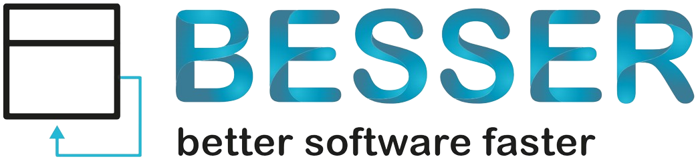
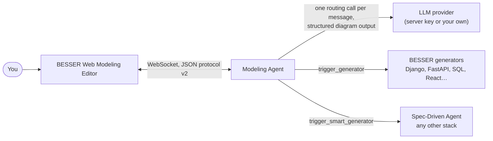

<div align="center">
  <picture>
    <source media="(prefers-color-scheme: dark)" srcset="./docs/source/_static/besser_logo_dark.png">
    
  </picture>

  <h1>Modeling Agent</h1>

  <h3>Describe a system in plain language. Get a UML model you can generate code from.</h3>

  <p>The conversational modeling assistant of the
  <a href="https://editor.besser-pearl.org">BESSER Web Modeling Editor</a>,
  built on the <a href="https://github.com/BESSER-PEARL/BESSER-Agentic-Framework">BESSER Agentic Framework</a>.</p>

  <p>
    <a href="https://editor.besser-pearl.org"><b>Try it in the editor</b></a> ·
    <a href="https://modeling-agent.readthedocs.io/en/latest/">Docs</a> ·
    <a href="https://modeling-agent.readthedocs.io/en/latest/websocket_protocol.html">WebSocket protocol</a> ·
    <a href="https://github.com/BESSER-PEARL/modeling-agent/releases">Releases</a>
  </p>

[](https://github.com/BESSER-PEARL/modeling-agent/actions/workflows/tests.yml)
[](https://modeling-agent.readthedocs.io/en/latest/)
[](https://github.com/BESSER-PEARL/modeling-agent/releases/latest)
[](https://www.python.org/downloads/)
[](LICENSE.md)

</div>

The Modeling Agent is the WebSocket service behind the assistant of the BESSER Web Modeling
Editor. You ask it for a model in your own words: "a library with books, members and loans",
"add an email to User", "turn this PlantUML into a class diagram". It replies with **diagram
operations** that the editor applies to the canvas, and it hands finished models to BESSER's
code generators.



## Features

- **Models from natural language.** Create a complete system, add a single element, or
  modify what is already on the canvas, across ten diagram types.
- **One routing decision per message.** A single LLM classification call
  (`src/routing/unified_classifier.py`) decides what each message asks for; a local
  TensorFlow intent classifier is the fallback.
- **Multi-step requests.** "Model a shop, then generate a Django app" is planned and run
  as an ordered sequence of operations.
- **Code generation hand-off.** Requests for a stack BESSER supports go to its
  deterministic generators; anything else goes to the LLM-authored **Spec-Driven Agent**.
- **Bring your own key.** Generation and conversation can run on the user's own OpenAI,
  Anthropic or OpenAI-compatible key, held only by that user's socket.
- **Files in, diagrams out.** PlantUML, knowledge graphs, XMI, PDFs, images and plain text
  are converted into diagram specifications.
- **UML questions answered from the source.** Retrieval over the OMG UML 2.5.1
  specification.
- **Project history and provenance.** While trace recording is on, the editor sends its
  trace record (`context.traceDigest`) and the agent answers which code came from an element,
  which requirement it realizes, who changed what and when, what is out of date and which
  requirements the model does not cover, then offers to open the Traceability page
  (`show_trace`).
- **Requirements from the request.** For a project that records traces
  (`context.traceabilityEnabled`, opt-in), a complete-system request also yields its
  requirements and the class-diagram elements that realize them (`requirements` and
  `realizations` on `inject_complete_system`).
- **Token usage per turn.** Terminal replies report the tokens of that turn's LLM calls
  (`llmUsage`).
- **Voice and language.** Voice messages through speech-to-text, and replies in the
  language the user writes in.
- **Robust sessions.** Replies are replayed after a reconnect, and a lost conversation
  memory is rebuilt from the editor's recent history.

## Supported diagram types

| Diagram type | Single element | Complete system | Modification |
| --- | --- | --- | --- |
| `ClassDiagram` | Yes | Yes | Yes |
| `ObjectDiagram` | Yes | Yes | Yes |
| `StateMachineDiagram` | Yes | Yes | Yes |
| `AgentDiagram` | Yes | Yes | Yes |
| `GUINoCodeDiagram` | Yes | Yes | Yes |
| `QuantumCircuitDiagram` | Yes | Yes | Yes |
| `BPMN` | Yes | Yes | Yes |
| `UserDiagram` | Yes | Yes | Yes |
| `ComponentDiagram` | Yes | Yes | Yes |
| `DeploymentDiagram` | Yes | Yes | Yes |

The identifier is the value `get_diagram_type()` returns: the editor's storage-bucket
token, which the protocol, the factory and `SUPPORTED_DIAGRAM_TYPES` all key on. BPMN's
token is `BPMN` (not `BPMNDiagram`) and the user-profile token is `UserDiagram`.

- `BPMN` also covers **Agentic BPMN**: agent-swarm lanes with roles, trust scores,
  multiplicity, reflection modes and governed merging gateways.
- `ComponentDiagram` uses the editor's agentic stereotype vocabulary (`solution` /
  `supervision` agents, `skill` / `tool` / `llm` / `db` / `rag` capabilities, and agentic
  dependency kinds).
- `AgentDiagram` also covers agent components (intents, LLMs, RAG databases, tools,
  skills, workspaces, GUIs) and all 17 state reply types.

## Code generation

Deterministic BESSER generators (`GENERATOR_KEYWORDS` in `src/routing/generation_signals.py`):
`django`, `backend`, `web_app`, `sql`, `sqlalchemy`, `python`, `java`, `pydantic`,
`jsonschema`, `smartdata`, `agent`, `qiskit`, `rest_api`, `rdf`, plus the `export` and
`deploy` actions.

Anything outside that list, such as a non-BESSER language or framework, or a BESSER stack
plus extras the template cannot produce (auth, Docker, migrations…), goes to the
**Spec-Driven Agent** through a `trigger_smart_generator` payload.

## Quick start

**No install:** open [editor.besser-pearl.org](https://editor.besser-pearl.org) and use the
assistant. The [assistant guide](https://besser.readthedocs.io/projects/besser-web-modeling-editor/en/latest/user-guide/ai-assistant.html)
shows what to ask.

**Run it locally** (Python 3.11 and a provider key):

```bash
git clone --branch develop https://github.com/BESSER-PEARL/modeling-agent.git
cd modeling-agent
python -m venv .venv
source .venv/bin/activate            # Windows PowerShell: .\.venv\Scripts\Activate.ps1
python -m pip install -r requirements.txt
python -m pip install -e .
cp config_example.yaml config.yaml   # then set nlp.openai.api_key
python modeling_agent.py
```

The socket opens at `ws://localhost:8765` once startup finishes. Startup takes a few
minutes by design: the framework trains its local classifiers before opening the socket.
To connect a local editor, set its `UML_BOT_WS_URL` to that address and allow the editor's
origin under `platforms.websocket.origins` in `config.yaml`. See
[Run the Modeling Agent locally](https://modeling-agent.readthedocs.io/en/latest/getting_started.html).

**With Docker:**

```bash
docker build -t modeling-agent .
docker run -p 8765:8765 -e OPENAI_API_KEY=sk-... modeling-agent
```

The image's entrypoint writes `config.yaml` from the environment (redacting the API key in
its debug output). The healthcheck allows a 300 s `start-period` for the slow boot.

## Configuration

Settings live in `config.yaml` (copied from `config_example.yaml`). The most used
environment overrides are below; the full list is in
[Configuration](https://modeling-agent.readthedocs.io/en/latest/configuration.html).

| Variable | Purpose |
| --- | --- |
| `BESSER_AGENT_MODEL_*` | Re-point one model tier (`CLASSIFIER`, `GENERATION_LARGE`, `GENERATION_GUI`, `GENERATION_SMALL`, `REASONING`, `VISION`, `EMBEDDINGS`), plus `REASONING_EFFORT` |
| `BESSER_BACKEND_URL` | BESSER backend base URL (diagram validation and telemetry) |
| `BESSER_AGENT_ALLOW_CUSTOM_BASE_URL` | Whether a BYOK request may supply its own API base URL (required for PIA, Ollama and other OpenAI-compatible endpoints) |
| `BESSER_AGENT_STT_LANGUAGE` | Pin speech-to-text to a language instead of auto-detect |
| `BESSER_AGENT_COST_LOG_INTERVAL` | Seconds between INFO log lines with the token and cost totals (default 600, `0` disables) |
| `LOG_PROMPTS` | Log full LLM prompts (local debugging only) |

Which model each call uses, what a turn costs and how retries are bounded: see "Cost and
Model Routing" in the configuration guide.

## Deployment

The agent is one of **three services** deployed together: the BESSER backend (`:9000`),
this agent (`:8765`) and the editor frontend (`:8080`), behind one nginx reverse proxy that
terminates TLS and exposes the agent at `wss://<host>/agent`. See
[Deployment](https://modeling-agent.readthedocs.io/en/latest/deployment.html).

> `patches/websocket_platform.py` is copied over the pip-installed BAF 4.5.3 file at image
> build time. Stock BAF evicts the `_connections` slot unconditionally on close; with the
> stable `?user_id=` param the two sockets a browser tab opens share one session key, so a
> closing socket would drop the live one's replies. Re-vendor if the BAF version bumps.

## Protocol

The agent consumes assistant payloads with `protocolVersion: "2.0"`. In BESSER WebSocket
mode the payload is usually serialized inside the top-level `message` field:

```json
{
  "action": "user_message",
  "message": "{\"action\":\"user_message\",\"protocolVersion\":\"2.0\",\"clientMode\":\"workspace\",\"message\":\"create a User class\",\"context\":{\"activeDiagramType\":\"ClassDiagram\"}}"
}
```

It is normalized into an internal `AssistantRequest` (`src/protocol/types.py`). Terminal
responses are `inject_complete_system`, `inject_element`, `modify_model`,
`assistant_message`, `trigger_generator`, `trigger_smart_generator`, `trigger_export`,
`trigger_deploy`, `trigger_github_import`, `auto_generate_gui`, `create_diagram_tab` and
`agent_error`; `progress` and `stream_start` / `stream_chunk` / `stream_done` are
non-terminal. Full payload shapes:
[WebSocket protocol](https://modeling-agent.readthedocs.io/en/latest/websocket_protocol.html).

## Documentation

| If you want to… | Read |
| --- | --- |
| Use the assistant in the editor | [Assistant guide](https://besser.readthedocs.io/projects/besser-web-modeling-editor/en/latest/user-guide/ai-assistant.html) |
| Run the service | [Local setup](https://modeling-agent.readthedocs.io/en/latest/getting_started.html) · [Configuration](https://modeling-agent.readthedocs.io/en/latest/configuration.html) · [Troubleshooting](https://modeling-agent.readthedocs.io/en/latest/troubleshooting.html) |
| Integrate a client | [WebSocket protocol](https://modeling-agent.readthedocs.io/en/latest/websocket_protocol.html) · [End-to-end flow](https://modeling-agent.readthedocs.io/en/latest/end_to_end_flow.html) |
| Extend the agent | [Architecture](https://modeling-agent.readthedocs.io/en/latest/architecture.html) · [Contributor guide](https://modeling-agent.readthedocs.io/en/latest/contributing.html) |
| See what changed | [Release notes](https://modeling-agent.readthedocs.io/en/latest/releases.html) |

The B-UML language and the generators are documented in the
[BESSER docs](https://besser.readthedocs.io/en/latest/).

## Development

<details>
<summary>Repository layout</summary>

```text
modeling-agent/
  modeling_agent.py                # Runtime entrypoint: agent, states, intents, wiring
  config_example.yaml              # Template for the gitignored config.yaml
  Dockerfile                       # Image + entrypoint that writes config.yaml from env
  patches/websocket_platform.py    # Vendored BAF fix (see Deployment)
  src/                             # One package per layer, top to bottom:
    app/                           # Bootstrapping, state bodies + transition wiring, pending flows
    ingestion/                     # File attachments: detection, conversion, the attachment step
    execution/                     # Operation execution engine (planning, model ops)
    codegen/                       # Generator requests, Spec-Driven Agent trigger
    orchestrator/                  # Multi-operation planning + diagram-type resolution
    conversation/                  # Reply/streaming helpers, reply language, suggestions, telemetry
    routing/                       # ONE classification call per message (routing brain) + signals
    memory/                        # Conversation memory + rolling summary
    diagram_handlers/
      core/                        # Base handlers + deterministic layout
      types/                       # Concrete per-diagram handlers
      registry/                    # Factory + metadata registry
    prompts/                       # Prompt text, one module per diagram type or state
    llm/                           # LLM provider, retry, bring-your-own-key, model tiers, token/cost tracking
    utilities/                     # Shared context/model/request helpers, bundled User Profile metamodel (data/)
    protocol/                      # Wire actions, request parsing and protocol types
    common/                        # Settings, tunable constants, session-state keys, pending dialogs, error taxonomy
    schemas/                       # Pydantic schemas for structured LLM output
  tests/
  docs/
```

</details>

```bash
pip install -r requirements-dev.txt
pip install -e .
python -m pytest                     # full suite
python -m pytest tests/test_protocol.py
```

Build the docs with `pip install -r docs/requirements.txt` and `python docs/check_docs.py`,
the same gate CI runs.

`develop` is the integration branch and `main` is production; open pull requests against
`develop`. Keep behavior changes synchronized across `src/`, `tests/` and `docs/source/`.
See [CONTRIBUTING.md](CONTRIBUTING.md), [GOVERNANCE.md](GOVERNANCE.md) and the
[Code of Conduct](CODE_OF_CONDUCT.md).

## Security

Never commit real API keys: `config.yaml` and `.env` are gitignored, and
`config_example.yaml` and `.env.example` are the templates.

## Citation and license

If you use the Modeling Agent in research, cite it with the metadata in
[CITATION.cff](CITATION.cff) (GitHub's "Cite this repository" button reads it).

Released under the [MIT License](LICENSE.md). The Modeling Agent is part of
[BESSER](https://github.com/BESSER-PEARL/BESSER), a low-code platform led by the
[Luxembourg Institute of Science and Technology](https://www.list.lu/) and funded by an FNR
Pearl grant.
